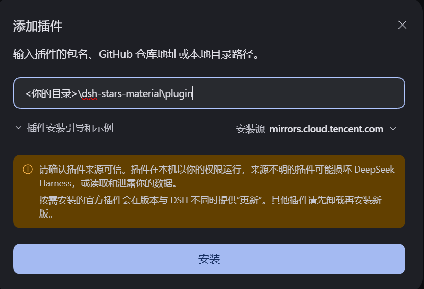

# dsh-stars-material

> [!IMPORTANT]
> made by pure vibe coding

适用于 DeepSeek Harness Desktop 的 Material 3 主题插件。安装后前往 **设置 → Material 3** 即可开启主题并自定义配色。

## 功能特性

- **同步生成明暗配色**：根据选定的主题色自动生成配套的浅色与深色界面，切换明暗模式时整体风格保持统一。
- **以背景明暗区分层次**：通过不同深浅的背景色区分侧边栏、卡片、输入框与弹窗，减少传统边框线条和阴影；悬停与点击时以半透明叠色呈现反馈。
- **三种配色方式**：
  - **跟随系统**：自动读取 Windows 系统主题色生成配色（非 Windows 系统或系统未设置彩色主题色时自动使用默认配色）。
  - **内置预设**：内置 8 套常用配色方案，可随时切换。
  - **自定义颜色**：通过取色器或 `#rrggbb` 色值自由指定任意主题色。
- **即改即生效**：设置修改实时应用并自动保存在本地，刷新页面后保持不变，无需重启应用。

## 安装

1. 克隆仓库并进入 `plugin` 目录查看本地完整路径：

```powershell
git clone https://github.com/qiMengStars/dsh-stars-material.git
cd dsh-stars-material/plugin
pwd
```

2. 在 DeepSeek Harness Desktop 的插件管理页面点击「添加插件」，填入上述 `plugin` 目录的本地路径（例如 `<你的目录>\dsh-stars-material\plugin`）并安装：



3. 安装完成后，前往 **设置 → Material 3** 启用主题并选择配色方案。

## 目录结构

```text
LICENSE                   项目 MIT 协议全文
plugin/                   可安装的插件包目录
  package.json            插件清单（exports、files、dsh.bundle.patch、dsh.client）
  cordis.patch.yml        Cordis 插件列表注入补丁
  index.js                Host 端入口：读取系统强调色并提供配色 HTTP 路由
  client.js               Client 端构建产物（打包后的浏览器主题脚本）
  icon.svg                插件图标
  locale/*.json           中英文界面与插件元数据文案
  lib/palette.js          供 Host 端使用的调色板生成模块（自动生成）
  lib/mcu/**              随包分发的 Material Color Utilities 0.4.0（自动生成）
  LICENSE                 随插件包分发的 MIT 协议全文
src/                      主题源码
  parts/palette-spec.js   色彩角色顺序、预设定义与 CSS 桥接变量列表
  parts/palette-engine.js 种子色推导、紧凑编码与对比度计算引擎
  parts/token-map.js      宿主 CSS 变量映射表
  client/main.js          Client 入口、偏好存储、主题注册与设置页面
  client/stylesheet.js    补充样式规则（圆角刻度、动效曲线与特定组件覆写）
  generated/palettes.js   内置预设的预计算调色板数据（自动生成）
build/                    构建、校验与开发期辅助脚本
vendor/                   本地缓存的上游依赖与宿主参考样式
  dsh-survey/             从宿主提取的参考样式表与声明（MIT）
  material-color-utilities/
                          打过 ESM 扩展名补丁的 Material Color Utilities 0.4.0（Apache-2.0）
```

## 开发与校验

修改源码后，运行以下命令重新生成构建产物并执行全套离线校验：

```powershell
node build/verify.mjs
```

- `src/generated/palettes.js`、`plugin/client.js` 与 `plugin/lib/**` 均为构建脚本自动生成的产物，请勿直接手动编辑。
- 仅修改客户端代码并重新构建后，刷新应用页面即可生效；修改 Host 端代码（`plugin/index.js` 或 `plugin/lib/**`）后，需要重启 DeepSeek Harness 才会加载新版本。

## 已知限制

- 「跟随系统」目前仅支持 Windows，其他系统会自动使用默认配色。
- 深色模式及部分浮层组件（菜单、对话框、提示框）在去除投影后的层次感仍在持续优化。
- 受宿主原生界面结构限制，以下细节暂未完全贴合 Material 3 风格：
  - 开关（Switch）尺寸与原生复选框（Checkbox）外观。
  - 部分按钮圆角、标签页（Tab）指示器与默认字体。
  - 少数依赖边框绘制的细分割线以及两处环形进度条底轨不再显示（进度前景与文字不受影响）。

## 开源协议

- 本项目代码采用 MIT 协议（见根目录 [LICENSE](LICENSE) 与 [plugin/LICENSE](plugin/LICENSE)）。
- `vendor/material-color-utilities/` 与 `plugin/lib/mcu/` 内置的 Material Color Utilities 遵循 Apache-2.0 协议（见各自目录下的 `LICENSE`）。
- `vendor/dsh-survey/` 中提取的 DeepSeek Harness 样式表遵循 MIT 协议（`Copyright (c) 2026 DeepSeek`，见 [vendor/dsh-survey/LICENSE](vendor/dsh-survey/LICENSE)）。
